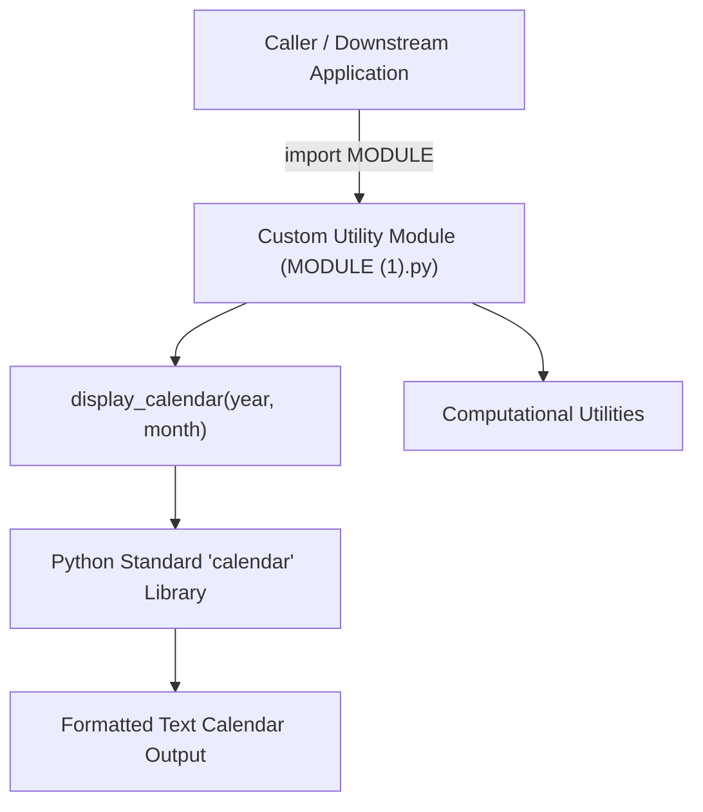

<p align="center">
  
</p>

<p align="center">
  
  
  
  
</p>

<a id="overview"></a>
## 📖 Executive Summary & Overview

Reusable software libraries empower developers to avoid redundant code and maintain consistent logic across larger software platforms. Designing a custom Python module requires organizing utility functions behind a clean public API, providing sensible default arguments, and preventing side-effects upon module import.

The **Python Utility Modules** project (`Python-project`) implements a versatile multi-functional utility module in `MODULE (1).py`. The package features automated calendar generation, date formatting, arithmetic helpers, and display formatting utilities built using Python's standard library.

<a id="toc"></a>
## 📑 Table of Contents

- [📖 Executive Summary & Overview](#overview)
- [🎯 Key Features & Capabilities](#features)
- [🏗️ System Architecture & Pipeline](#architecture)
- [🛠️ Tech Stack Breakdown](#tech-stack)
- [⚙️ Reproducible Quickstart & Setup](#setup)
- [📁 Project Directory Layout](#project-layout)
- [👨‍💻 Author & Contributions](#author)

<a id="features"></a>
## 🎯 Key Features & Capabilities

- **Automated Calendar Generation:** `display_calendar(year, month)` formatting and printing structured monthly calendar matrices.
- **Date Verification & Leap Year Logic:** Calculation of month boundaries and leap year days.
- **Modular Function Export:** Structured public functions easily imported across downstream Python applications.
- **Zero External Dependencies:** Built solely on Python's built-in `calendar` and standard libraries.

<a id="architecture"></a>
## 🏗️ System Architecture & Pipeline



<a id="tech-stack"></a>
## 🛠️ Tech Stack Breakdown

| Component | Library / Language | Role |
| :--- | :--- | :--- |
| **Language** | Python 3.8+ | Primary scripting environment |
| **Core Utilities** | `calendar` module | Built-in date and calendar formatting |
| **Module Architecture** | Python Packaging Conventions | Function isolation and modular namespaces |

<a id="setup"></a>
## ⚙️ Reproducible Quickstart & Setup

### Prerequisites
- Python 3.8 or higher installed

```bash
# 1. Clone repository
git clone https://github.com/Amaraiah11/Python-project.git
cd Python-project

# 2. Test the custom module in Python interactive shell
python -c "import importlib; mod = importlib.import_module('MODULE (1)'); mod.display_calendar(2026, 10)"
```

<a id="project-layout"></a>
## 📁 Project Directory Layout

```text
Python-project/
├── MODULE (1).py              # Core reusable utility module implementation
└── README.md                  # Comprehensive module usage and API documentation
```

<a id="author"></a>
## 👨‍💻 Author & Contributions

This project is developed and maintained with high technical rigour by **Amaraiah C**, Software Engineer and Data Analytics Practitioner studying Bachelor of Computer Applications (BCA) at Alliance University.

- 🌐 **GitHub:** [@Amaraiah11](https://github.com/Amaraiah11)
- 💼 **LinkedIn:** [Connect on LinkedIn](https://www.linkedin.com/in/amaraiah-c/)
- 📧 **Institutional Contact:** `camaraiahBCA24@ced.alliance.edu.in`

### 🤝 Contribution Guidelines
Contributions, bug reports, and architectural discussions are welcome!
1. **Fork** the repository: `https://github.com/Amaraiah11/Python-project`
2. **Branch**: `git checkout -b feature/your-feature-name`
3. **Commit**: `git commit -m "feat: enhance feature logic"`
4. **Push**: `git push origin feature/your-feature-name`
5. **Open Pull Request** against the `main` branch.

---

<p align="center">
  <b>⭐ If this codebase or documentation assisted your engineering workflows, please star the repository! ⭐</b>
</p>

<p align="center">
  
</p>
