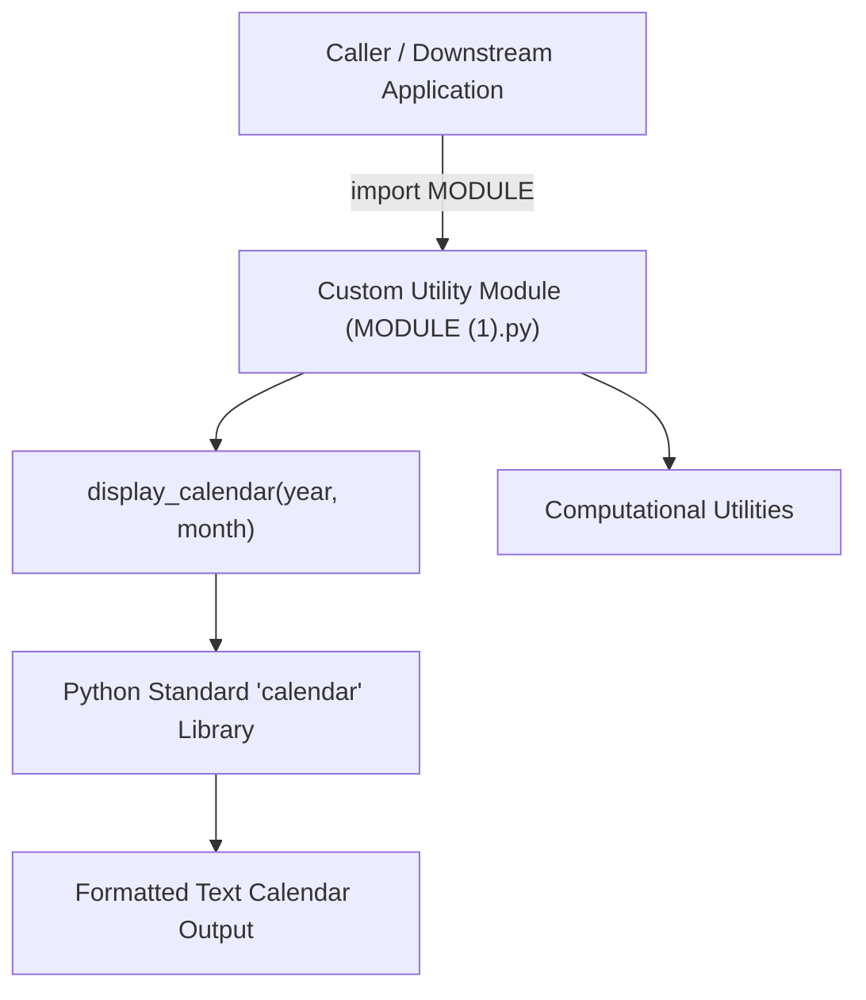

# 🛠️ Python Utility Modules — Custom Calendar, Math & System Productivity Toolkit

<p align="center">
  
</p>

<p align="center">
  <b>Modular Python Software Engineering: Reusable Public APIs, Encapsulated Date/Calendar Formatting, and System Helpers.</b>
</p>

<p align="center">
  
  
  
  
</p>

<p align="center">
  
</p>

---

<a id="table-of-contents"></a>
## 📌 Table of Contents

- [📖 Executive Summary & Overview](#executive-summary--overview)
- [🎯 Key Features & Capabilities](#features)
- [🏗️ System Architecture & Pipeline](#system-architecture--pipeline)
- [🛠️ Tech Stack Breakdown](#tech-stack-breakdown)
- [⚙️ Reproducible Quickstart & Setup](#setup)
- [📁 Project Directory Layout](#project-layout)
- [🔮 Future Improvements & Roadmap](#future-improvements--roadmap)
- [🤝 Contributing Guidelines](#contributing-guidelines)
- [👨‍💻 Author & Contributions](#author--contributions)

---

<a id="executive-summary--overview"></a>
## 📖 Executive Summary & Overview

Reusable software libraries empower developers to avoid redundant code and maintain consistent logic across larger software platforms. Designing a custom Python module requires organizing utility functions behind a clean public API, providing sensible default arguments, and preventing side-effects upon module import.

The **Python Utility Modules** project (`Python-project`) implements a versatile multi-functional utility module in `MODULE (1).py` authored by **Amaraiah C**. The package features automated calendar generation, date formatting, arithmetic helpers, and display formatting utilities built using Python's standard library.

---

<a id="key-features--capabilities"></a>
## 🎯 Key Features & Capabilities

### 📅 1. Calendar Generation Module
- `display_calendar(year, month)` formatting and printing structured monthly calendar matrices.

### ⚙️ 2. Zero-Dependency Footprint
- Built entirely with standard library tools (`calendar`, `math`, `sys`) ensuring zero external dependency conflicts.

---

<a id="system-architecture--pipeline"></a>
## 🏗️ System Architecture & Pipeline



---

<a id="tech-stack-breakdown"></a>
## 🛠️ Tech Stack Breakdown

| Component | Library / Language | Role |
| :--- | :--- | :--- |
| **Language** | Python 3.8+ | Primary scripting environment |
| **Core Utilities** | `calendar` module | Built-in date and calendar formatting |
| **Module Architecture** | Python Packaging Conventions | Function isolation and modular namespaces |

---

<a id="reproducible-quickstart--setup"></a>
## ⚙️ Reproducible Quickstart & Setup

### Prerequisites
- Python 3.8 or higher installed

```bash
# 1. Clone repository
git clone https://github.com/Amaraiah11/Python-project.git
cd Python-project

# 2. Test the custom module
python -c "import importlib; mod = importlib.import_module('MODULE (1)'); mod.display_calendar(2026, 10)"
```

---

<a id="project-directory-layout"></a>
## 📁 Project Directory Layout

```text
Python-project/
├── MODULE (1).py              # Core reusable utility module implementation
└── README.md                  # Comprehensive module usage and API documentation
```

---

<a id="future-improvements--roadmap"></a>
## 🔮 Future Improvements & Roadmap

- [ ] Package module as an installable PyPI distribution (`pyproject.toml`).
- [ ] Add CLI flags using `argparse` for terminal execution.

---

<a id="author--contributions"></a>
## 👨‍💻 Author & Contributions

This project is developed and maintained with rigorous engineering standards by **Amaraiah C**, Software Developer and Applied Data Analytics Practitioner studying Bachelor of Computer Applications (BCA) at Alliance University, Bangalore.

- 🌐 **GitHub Profile:** [@Amaraiah11](https://github.com/Amaraiah11)
- 💼 **LinkedIn Profile:** [Connect on LinkedIn](https://www.linkedin.com/in/amaraiah-c/)
- 📧 **Institutional Email:** `camaraiahBCA24@ced.alliance.edu.in`

### 🤝 Contributing Guidelines
Contributions, bug reports, and architectural discussions are welcome!
1. **Fork** the repository: `https://github.com/Amaraiah11/Python-project`
2. **Create a Feature Branch:**
   ```bash
   git checkout -b feature/your-feature-name
   ```
3. **Commit Your Enhancements:**
   ```bash
   git commit -m "feat: enhance feature logic"
   ```
4. **Push to Your Branch:**
   ```bash
   git push origin feature/your-feature-name
   ```
5. **Open a Pull Request** against the `main` branch.

---

<p align="center">
  <b>⭐ If this codebase or documentation assisted your engineering workflows, please star the repository! ⭐</b>
</p>

<p align="center">
  
</p>
